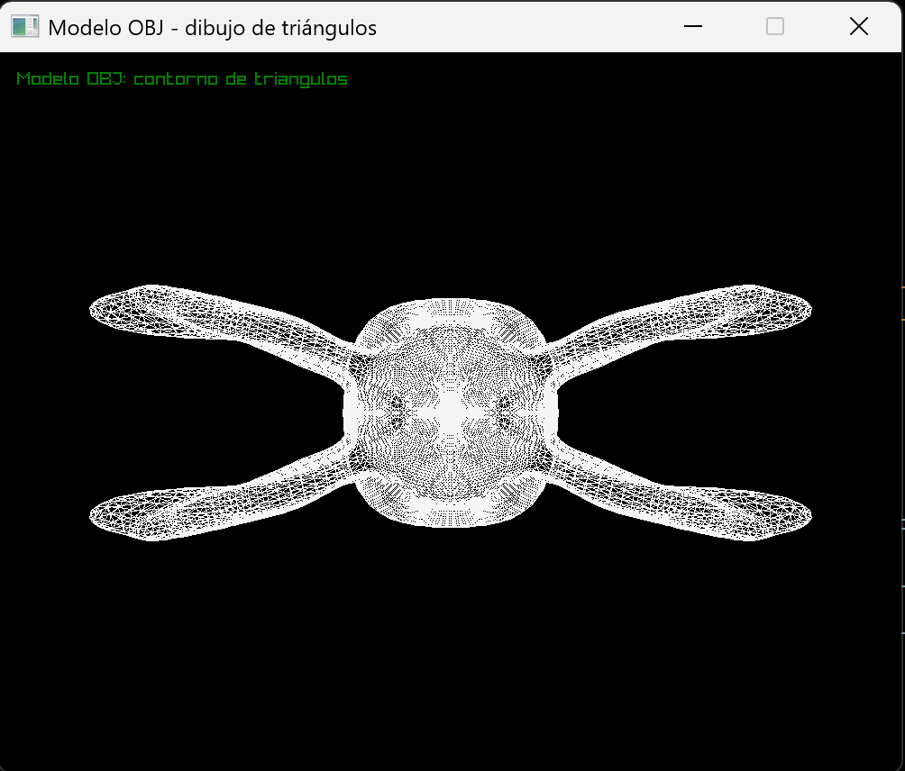

# Renderer de modelo OBJ

Este proyecto carga un modelo Wavefront OBJ y dibuja el contorno de sus triángulos
utilizando funciones propias de punto, línea y triángulo.

## Ejecutar

Desde la carpeta del proyecto:

```bash
cargo run --release
```

## Captura del modelo OBJ en ejecución

